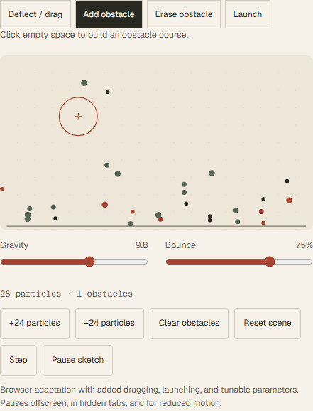

# CSCI-2081-Projects
Here is my work for CSCI 2081 Projects under instruction of Prof. Daniel T. Orban.
This class was taken at **2024 fall semester**.
Please reach out to me with any problems.
Basically, Proj 2 is about balls collapsing to each other and 3 is cooperating with dataset.

<!-- BEGIN portfolio-project-animations -->
## Recorded project interactions

These previews record interaction with original project figures, saved notebook outputs, source tests, or the actual project interface. They do not represent new experiments, model inference, or benchmark runs. Pointer-driven inspection, saved-result selection, and browser controls are captured below.

### Particle playground

Recorded browser adaptation of the original Processing controls: construct and erase obstacles, drag circles, launch particles, and tune gravity and bounce. This is not a replay of the Processing runtime.

[Original project material](https://github.com/Ztang-Yit-Xiaang/Particle-Obstacle-Collision-Animation-SimulationProjects)

<!-- END portfolio-project-animations -->

